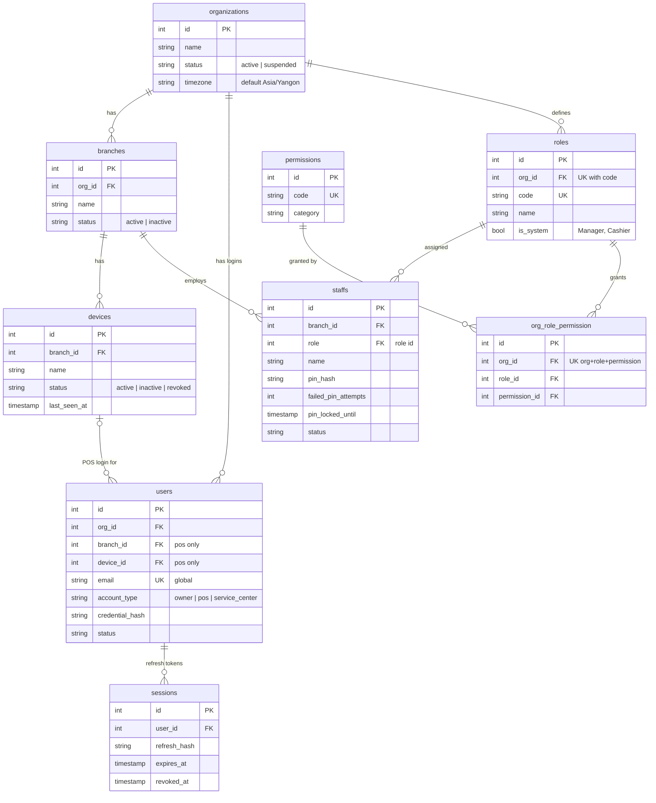
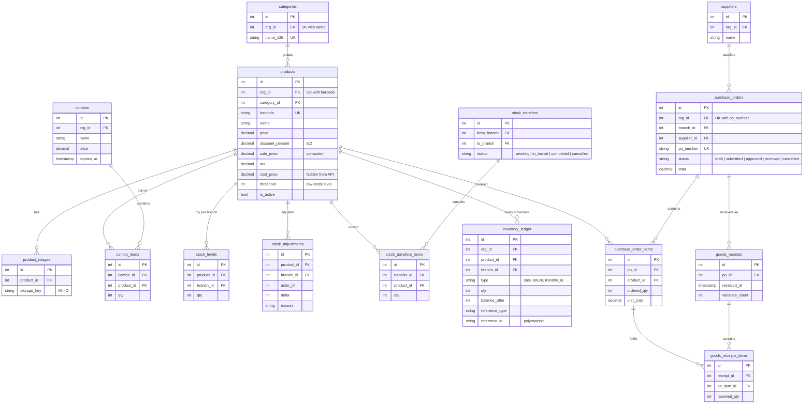
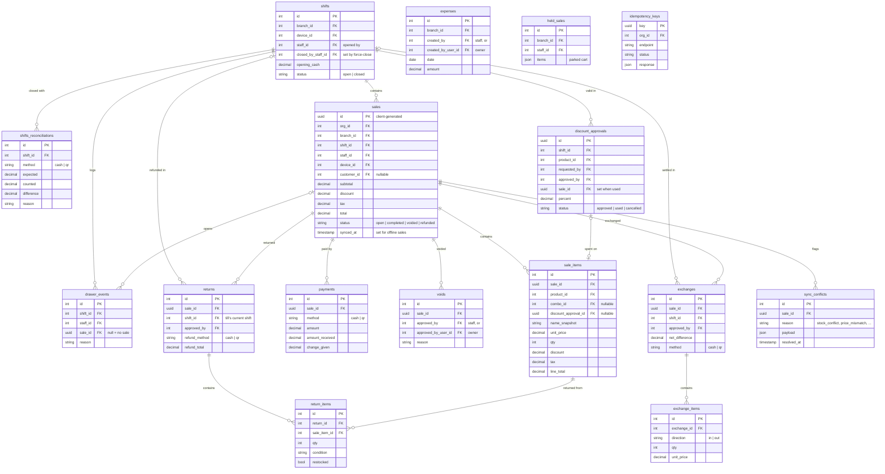
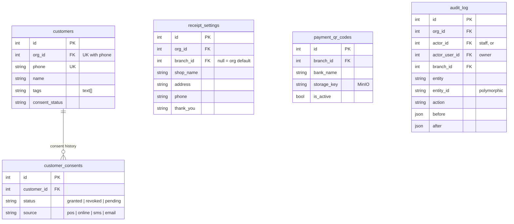

# Database (ERD)

Generated from the GORM models in `internal/*/*_model.go` (October 2026).
49 tables on PostgreSQL, created by GORM AutoMigrate at start-up
(`internal/migrate/migrate.go`).

> **Read this first**
> - **There are no database-level foreign keys.** Every "FK" below is an indexed
>   column whose integrity is enforced by the service code, not by Postgres.
> - **Multi-tenant:** most tables carry `org_id` directly; the rest are scoped
>   through `branch_id` or their parent row.
> - **Money** is `decimal(10,2)` (`shopspring/decimal`); percentages are
>   `decimal(5,2)`.
> - **Sales use UUID primary keys**, generated by the till, so a sale made offline
>   keeps its id when it syncs.
> - **No soft deletes:** deletes are hard deletes.

The diagrams are split by domain; a table that belongs to another domain
appears with its key only.

## 1. Organisation, people and access

- **Two kinds of identity.** `users` are logins (Owner, Service Center, and one
  per POS device). `staffs` are the people at a till, who sign in with a PIN
  on a device that is already logged in. An Owner has no `staffs` row.
- **Roles are per organisation.** `org_role_permission` is the live grant table.
  `role_permission` (not drawn) is the legacy global table, kept only as a
  migration source. `data_migrations` records one-off data migrations that have
  run.

## 2. Catalog, stock and purchasing

- **The catalog is org-wide; stock is per branch** (`stock_levels`).
- **`inventory_ledger` is append-only.** Every stock change (sale, return, void,
  exchange, adjustment, transfer, goods receipt) writes a row with
  `balance_after`, and `reference_type` + `reference_id` point back to the
  document that caused it.
- `combo_images` (not drawn) mirrors `product_images` for combos.

## 3. Selling: shifts, sales, after-sale, sync

- **A shift is one cashier's session on one device.** Close-shift compares
  expected and counted cash per payment method (`shifts_reconciliations`). Cash
  returns and exchanges count against the shift they happen in, which isn't
  necessarily the shift of the original sale.
- **Item snapshots:** `sale_items.name_snapshot` and `unit_price` keep the price
  as it was sold, so later catalog changes don't rewrite history.
- `sale_items` also stores how the discount was made up (catalog, manual, combo)
  and a hidden `unit_cost` snapshot for profit reports.
- Retries are de-duplicated by the sale's UUID (`POST /sales` replays an
  existing sale; `/sync/sales` skips one already received). `idempotency_keys`
  is created but **not used by any code**.

## 4. Customers, shop settings, audit

`customers` are linked from `sales.customer_id` and `held_sales.customer_ref`.
`translations_locales` (composite key `locale` + `key`) holds UI strings.

## Conventions and quirks

| Topic | Detail |
|---|---|
| Staff vs owner actor | An Owner has no staff row, so `expenses`, `voids` and `audit_log` carry two nullable actor columns (staff id / user id); exactly one is set. Returns, exchanges and discount approvals are staff-only. |
| Polymorphic references | `inventory_ledger.reference_type` + `reference_id`, `audit_log.entity` + `entity_id`. The id columns are `text`, so they can hold an integer or a UUID. |
| Uniqueness | Per org: product barcode, category name, customer phone, PO number, role code. Global: `users.email`, `permissions.code`. |
| Odd column names | `staffs.role` (a role id), `stock_transfers.from_branch` / `to_branch`, `held_sales.customer_ref`, `po_id` / `po_item_id`. |
| Custom table names | `staffs`, `role_permission`, `org_role_permission`, `audit_log`, `inventory_ledger`, `payment_qr_codes`, `shifts_reconciliations`, `goods_receipts_items`, `stock_transfers_items`, `translations_locales`. |
| JSON | `jsonb`: `held_sales.items`, `audit_log.before` / `after`, `sync_conflicts.payload`. Plain `json`: `idempotency_keys.response`. |

### Found while generating this

Raised as backend recommendations #20–#22:
- **Wrong table name in a migration:** `procurement_migrate.go:57` deletes from
  `goods_receipt_items`, but the table is `goods_receipts_items`. The path only
  runs for old databases whose `purchase_orders` lack `branch_id`.
- **No unique index on `stock_levels (product_id, branch_id)`.** A race could
  create two stock rows for one product at one branch.
- **No foreign keys at all.** Integrity depends on every code path being right.
  Worth adding at least for the money tables (`sales`, `sale_items`,
  `payments`).
