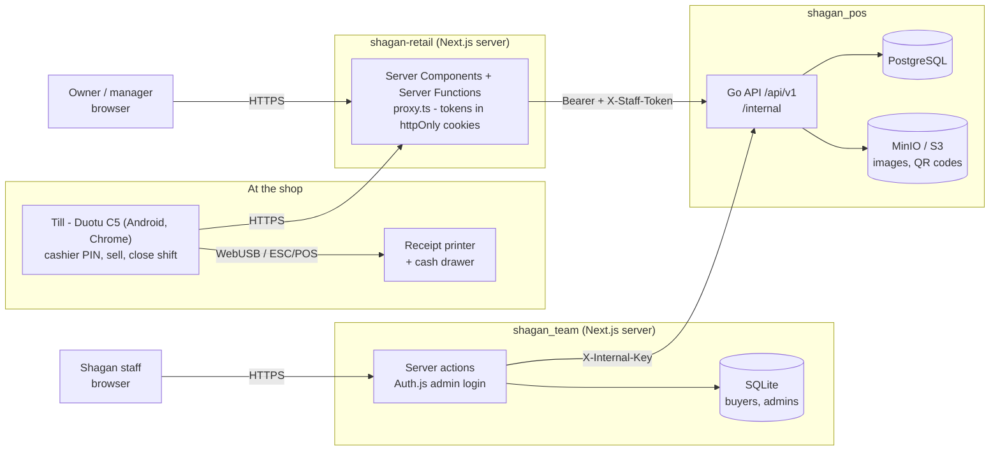

# Shagan POS - system overview

Shagan POS is a multi-tenant point-of-sale system for multi-branch retail
shops in Myanmar: priced in Kyat, with KBZ / AYA / Wave QR payments, and a UI
in English, Myanmar and Chinese.

## The three repositories

| Repo | What it is | Used by | Stack |
|---|---|---|---|
| [**shagan_pos**](https://github.com/channyein-thu/shagan_pos) (this repo) | The backend API, and the **source of truth for business rules** ([WORKFLOWS.md](WORKFLOWS.md)) | Every client | Go, Gin, GORM, PostgreSQL, MinIO |
| [**shagan-retail**](https://github.com/thiri-kyaw-khaing/shagan-retail) | The **POS till and Back Office** web app | Shop owners, managers, cashiers | Next.js 16, React 19, Tailwind |
| [**shagan_team**](https://github.com/channyein-thu/shagan_team) | **Internal provisioning portal**: sells and sets up tenants | Shagan staff | Next.js 16, Auth.js, Prisma + SQLite |

## System diagram

**Neither browser talks to the API directly.** Each frontend's Next.js server
calls it and keeps the credentials server-side. See
[ARCHITECTURE.md](ARCHITECTURE.md).

## Who does what

| Actor | Where | How they sign in | Can |
|---|---|---|---|
| **Shagan staff** | shagan_team | Admin email + password | Create a tenant (organisation, owner and service-center logins), branches, devices and till logins; suspend; reset passwords |
| **Owner** | shagan-retail Back Office | Email + password | Everything in their organisation, across all branches |
| **Service Center** | (portal stub) | Email + password | Same as owner on admin routes |
| **POS device** | shagan-retail till | Device email + password, once | Hosts cashier sessions |
| **Cashier** | Till | Picks name + 6-digit PIN | Open a shift, sell, hold, reprint, close their shift |
| **Manager / super staff** | Till | PIN; approves single actions | Discounts, no-sale drawer, void, return, exchange, force-close; Back Office for their branch |

## A tenant's lifecycle

1. **Shagan staff** create the organisation in shagan_team
   (`POST /internal/accounts`), then its branches, devices and one POS login
   per device.
2. The **owner** logs into Back Office: products, categories, combos, staff
   and roles (with PINs), suppliers, receipt settings, payment QR codes.
3. **At the till:** the device logs in once. Then for each person: pick a name
   → PIN → open shift (counted opening cash) → sell → close shift (counted
   cash vs expected).
4. **After the sale:** reprint, void (whole sale, shift still open), return,
   exchange, each needing a manager's approval where the rules say so.
5. The **owner** watches sales, stock, the audit log and reports.

The full rules are in [WORKFLOWS.md](WORKFLOWS.md).

## Where to read next

| Doc | For |
|---|---|
| [ARCHITECTURE.md](ARCHITECTURE.md) | Why it's built this way |
| [WORKFLOWS.md](WORKFLOWS.md) | Business rules, roles, permissions |
| [ERD.md](ERD.md) | Database |
| [STATUS.md](STATUS.md) | What's done and what isn't; risks |
| [backend-recommendations.md](backend-recommendations.md) | Open backend change requests |
| [shagan-retail docs/hardware.md](https://github.com/thiri-kyaw-khaing/shagan-retail/blob/main/docs/hardware.md) | Till printer and cash drawer |
